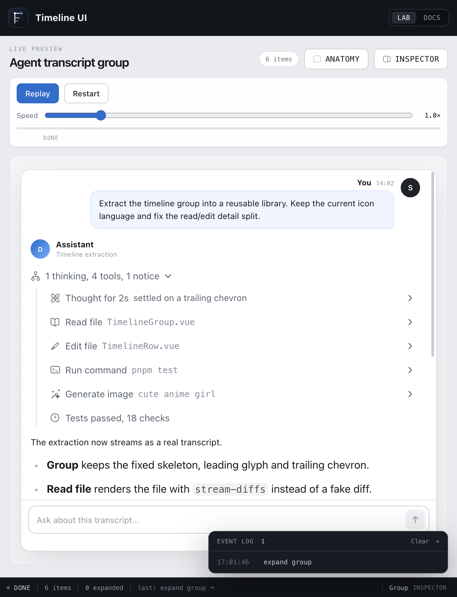

<p align="center">
  
</p>

<h1 align="center">Timeline UI</h1>

<p align="center">
  <a href="https://www.npmjs.com/package/@simon_he/timeline-ui"><code>@simon_he/timeline-ui</code></a><br />
  Fixed-layout, themeable Vue 3 timeline component for AI agent transcripts.<br />
  TypeScript, plain CSS, Vue as the only peer dependency.<br />
  <a href="https://github.com/Simon-He95/timeline-ui">GitHub</a>
  /
  <a href="https://timeline-ui.pages.dev/">Lab</a>
  /
  <a href="https://timeline-ui.pages.dev/?view=docs">Docs</a>
</p>

Timeline UI renders the stable skeleton of an agent turn: one group header, a
vertical rail, rows, disclosure and detail shells. The host supplies every
string, icon, panel and state transition.

```text
TimelineGroup
├─ group header       icon / summary / chevron
└─ reveal
   └─ rail            1px vertical line
      └─ TimelineRow  icon / label / primary / chevron
         └─ details   loading | host panel | error
```

<p align="center">
  
</p>

## Design principles

- **Fixed skeleton, variable skin.** The group and row structure is not
  replaceable through slots. Consumers customize text, icons, detail components
  and CSS variables.
- **No product coupling.** No i18n, store, desktop API, MCP, markdown, diff or
  data-fetching dependency. `vue` is the only peer dependency.
- **Data in, events out.** The host builds the view model, owns detail fetching
  and controls expansion when it wants to. The library never fetches or mutates
  host data.
- **Small public surface.** `TimelineGroup` is the only public component. Row
  and detail primitives are internal implementation details.

## Install

```bash
pnpm add @simon_he/timeline-ui vue
# or: npm install @simon_he/timeline-ui vue
```

```ts
import { TimelineGroup, type TimelineGroupVM } from '@simon_he/timeline-ui'
import '@simon_he/timeline-ui/style.css'
```

The style import is required. The JavaScript bundle has no CSS side effect
because the library build extracts the stylesheet into `style.css`.

## Quick start

```vue
<script setup lang="ts">
import { markRaw } from 'vue'
import { TimelineGroup, type TimelineGroupVM } from '@simon_he/timeline-ui'
import '@simon_he/timeline-ui/style.css'
import BookIcon from './BookIcon.vue'

const group: TimelineGroupVM = {
  summary: '1 tool',
  items: [
    {
      id: 'read-1',
      kind: 'tool',
      status: 'complete',
      label: 'Read file',
      primary: 'src/App.vue',
      icon: markRaw(BookIcon),
      detail: {
        status: 'loading',
      },
    },
  ],
}
</script>

<template>
  <TimelineGroup :group="group" :expanded="true" />
</template>
```

A detail starts in `loading`. When the host panel is ready, replace the whole
detail object with a `ready` one. Start that transition from `detail-toggle`.
The shell paints immediately, before the panel is available.

## API at a glance

| Prop | Type | Default | Meaning |
| --- | --- | --- | --- |
| `group` | `TimelineGroupVM` | required | Complete group view model |
| `expanded` | `boolean \| undefined` | `undefined` | Controlled group state; omit for internal state |
| `expandedItemIds` | `readonly string[] \| undefined` | `undefined` | Controlled open row ids; omit for internal state |
| `lazyDetails` | `boolean` | `true` | Do not mount a detail before its first open |
| `keepDetailsMounted` | `boolean` | `true` | Keep a detail shell mounted after its first open |

| Event | Payload | Meaning |
| --- | --- | --- |
| `update:expanded` | `(expanded: boolean)` | Group header was toggled |
| `update:expandedItemIds` | `(itemIds: string[])` | A row was toggled |
| `detail-toggle` | `(itemId: string, expanded: boolean)` | A row toggled; start loading here |
| `detail-retry` | `(itemId: string)` | The detail shell retry button was pressed |
| `activate` | `(itemId: string)` | An activatable row without details was pressed |

The only slot is `summary`, which receives `{ group: TimelineGroupVM }`. It
renders inside the group header button and accepts phrasing content only.

The package exports `TimelineGroup` plus its public view-model and event types.
`TimelineRow`, `TimelineDetails`, `TimelineChevron` and the fallback icon are
internal. Deep imports are blocked by the package `exports` map.

## Theming

All public knobs are CSS variables on `.timeline-ui`.

```vue
<TimelineGroup
  :group="group"
  :style="{
    '--timeline-ui-row-padding-y': '7px',
    '--timeline-ui-rail-color': '#c7d0da',
  }"
/>

<TimelineGroup :group="group" data-tone="dark" />
```

The library CSS is authored in `@layer timeline-ui`, so unlayered host CSS wins.
Prefer tokens for normal customization. The full token list, dark values and
live controls are in [Docs: Theming](https://timeline-ui.pages.dev/?view=docs#theming).

## Documentation

The live Docs cover concepts, host boundaries, accessibility, browser support,
the full type reference, slots, examples and every token:

- [Concepts and contract](https://timeline-ui.pages.dev/?view=docs#concepts)
- [Types](https://timeline-ui.pages.dev/?view=docs#types)
- [Props and events](https://timeline-ui.pages.dev/?view=docs#api)
- [Slots](https://timeline-ui.pages.dev/?view=docs#slots)
- [Examples](https://timeline-ui.pages.dev/?view=docs#examples)
- [Theming](https://timeline-ui.pages.dev/?view=docs#theming)
- [Live Lab](https://timeline-ui.pages.dev/)

Open the Lab to inspect group, row, details and token states live. The Docs and
Lab are deployed from `src/playground`.

## Development

Requires Node 20+ and pnpm 10.

```bash
pnpm install
pnpm dev        # Lab and Docs at http://localhost:4173
pnpm typecheck  # source, tests and configs
pnpm test       # Vitest + Vue Test Utils
pnpm build      # library -> dist/ (JS, CSS, rolled-up d.ts)
pnpm build:demo # Lab and Docs -> dist-demo/
pnpm preview    # preview the demo build
```

The Lab uses the public `TimelineGroup` entry, not a deep internal import. Its
streaming player, `stream-diffs` panels and `markstream-vue` markdown are
development dependencies only. They are not exported from the library entry or
included in the published package.

Read [CONTRIBUTING.md](https://github.com/Simon-He95/timeline-ui/blob/main/CONTRIBUTING.md) before opening a PR. Release steps live
in [RELEASING.md](https://github.com/Simon-He95/timeline-ui/blob/main/RELEASING.md). Report vulnerabilities through
[SECURITY.md](https://github.com/Simon-He95/timeline-ui/blob/main/SECURITY.md).

## License

MIT. Copyright 2026 Simon He. See [LICENSE](https://github.com/Simon-He95/timeline-ui/blob/main/LICENSE) and
[THIRD_PARTY_NOTICES.md](https://github.com/Simon-He95/timeline-ui/blob/main/THIRD_PARTY_NOTICES.md).
