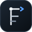
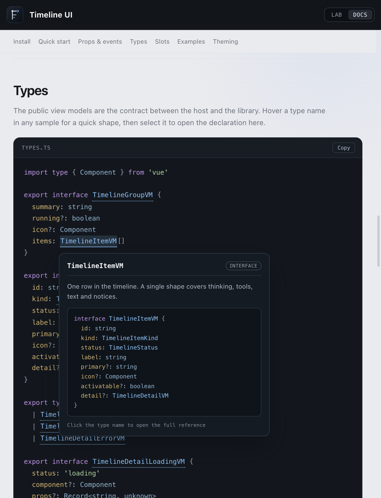

<p align="center">
  
</p>

<h1 align="center">Timeline UI</h1>

<p align="center">
  <a href="https://www.npmjs.com/package/@simon_he/timeline-ui"><code>@simon_he/timeline-ui</code></a><br />
  Fixed-layout, themeable timeline primitives for AI agent transcripts.<br />
  Vue 3, plain CSS, no runtime dependency other than Vue.<br />
  <a href="https://github.com/Simon-He95/timeline-ui">GitHub</a>
</p>

The library owns the skeleton: the group header, row grid, chevrons,
vertical rail, expand/collapse motion and the loading/error shell. The host owns
everything that changes per product: every string, icon, detail panel, data
fetch, expansion state and message layout.

```text
TimelineGroup
├─ group header       icon / summary / chevron
└─ reveal
   └─ rail            1px vertical line
      └─ TimelineRow  icon / label / primary / chevron
         └─ details   loading | host panel | error
```

<p align="center">
  
</p>

<p align="center">
  
</p>

## Contents

- [Design principles](#design-principles)
- [Install](#install)
- [Quick start](#quick-start)
- [Public API](#public-api)
- [Data model](#data-model)
- [Details lifecycle](#details-lifecycle)
- [Controlled and uncontrolled state](#controlled-and-uncontrolled-state)
- [Assistant message integration](#assistant-message-integration)
- [Theming](#theming)
- [Accessibility](#accessibility)
- [Layout contract](#layout-contract)
- [Browser and SSR support](#browser-and-ssr-support)
- [What stays in the host](#what-stays-in-the-host)
- [Development](#development)
- [Contributing](#contributing)
- [Releasing](#releasing)
- [License and third-party assets](#license-and-third-party-assets)

## Design principles

- **Fixed skeleton, variable skin.** The group and row structure is deliberately
  not replaceable through slots. Consumers customize text, icons, detail
  components and CSS variables.
- **No product coupling.** The package has no i18n, store, desktop API, MCP,
  markdown, diff or data-fetching dependency. `vue` is the only peer dependency.
- **Data in, events out.** The host builds the view model, owns detail fetching
  and controls expansion when it wants to. The library never fetches or mutates
  host data.
- **Small public surface.** `TimelineGroup` is the only public component. Row
  and detail primitives are internal implementation details.

## Install

```bash
pnpm add @simon_he/timeline-ui vue
# or: npm install @simon_he/timeline-ui vue
```

```ts
import { TimelineGroup, type TimelineGroupVM } from '@simon_he/timeline-ui'
import '@simon_he/timeline-ui/style.css'
```

The style import is required. The JavaScript bundle has no CSS side effect
because the library build extracts the stylesheet into `style.css`.

## Quick start

```vue
<script setup lang="ts">
import { markRaw, reactive, ref } from 'vue'
import {
  TimelineGroup,
  type TimelineGroupVM,
} from '@simon_he/timeline-ui'
import '@simon_he/timeline-ui/style.css'
import BookIcon from './BookIcon.vue'
import ReadPanel from './ReadPanel.vue'

const group = reactive<TimelineGroupVM>({
  summary: '1 tool',
  running: false,
  items: [
    {
      id: 'read-1',
      kind: 'tool',
      status: 'complete',
      label: 'Read file',
      primary: 'src/App.vue',
      icon: markRaw(BookIcon),
      detail: {
        status: 'ready',
        component: markRaw(ReadPanel),
        props: { path: 'src/App.vue' },
      },
    },
  ],
})

const groupOpen = ref(true)
const openItemIds = ref<string[]>([])

function onDetailToggle(itemId: string, expanded: boolean): void {
  if (!expanded) return
  const item = group.items.find((entry) => entry.id === itemId)
  if (!item || item.detail?.status === 'ready') return
  item.detail = { status: 'loading' }
  // then load the panel and replace item.detail with a ready object
}
</script>

<template>
  <TimelineGroup
    v-model:expanded="groupOpen"
    v-model:expanded-item-ids="openItemIds"
    :group="group"
    @detail-toggle="onDetailToggle"
  />
</template>
```

A detail starts in `loading`; when the host has the panel, it replaces the
detail object with a `ready` one. The skeleton paints immediately, even before
the host component is available.

## Public API

The package exports one component and its public types:

```ts
export { TimelineGroup }
export type {
  TimelineGroupProps,
  TimelineGroupEmits,
  TimelineGroupVM,
  TimelineItemVM,
  TimelineItemKind,
  TimelineStatus,
  TimelineDetailVM,
  TimelineDetailLoadingVM,
  TimelineDetailReadyVM,
  TimelineDetailErrorVM,
  TimelineDetailStatus,
}
```

`TimelineRow`, `TimelineDetails`, `TimelineChevron` and the fallback icon are
internal. Their class names and DOM structure are not a public styling API; use
the tokens below. Deep imports are blocked by the package `exports` map.

### `<TimelineGroup>`

| Prop | Type | Default | Meaning |
| --- | --- | --- | --- |
| `group` | `TimelineGroupVM` | required | The complete group view model |
| `expanded` | `boolean \| undefined` | `undefined` | Controlled group state; omit for internal state |
| `expandedItemIds` | `readonly string[] \| undefined` | `undefined` | Controlled open row ids; omit for internal state |
| `lazyDetails` | `boolean` | `true` | Do not mount a detail before its first open |
| `keepDetailsMounted` | `boolean` | `true` | Keep a detail shell mounted after its first open |

| Event | Payload | Meaning |
| --- | --- | --- |
| `update:expanded` | `(expanded: boolean)` | Group header was toggled |
| `update:expandedItemIds` | `(itemIds: string[])` | A row was toggled |
| `detail-toggle` | `(itemId: string, expanded: boolean)` | User toggled a row; start loading here |
| `detail-retry` | `(itemId: string)` | The shell retry button was pressed |
| `activate` | `(itemId: string)` | A row without details and with `activatable: true` was pressed |

`detail-toggle` and `update:expandedItemIds` both fire on a user row toggle.
Use the update event for state and `detail-toggle` for fetching.

| Slot | Props | Meaning |
| --- | --- | --- |
| `summary` | `{ group: TimelineGroupVM }` | Optional rich content for the group summary; the group/row skeleton and chevron stay fixed |

The summary slot renders inside the group header button. Use phrasing content
only; do not nest links, buttons or other interactive controls. Host icon
components should likewise be decorative and non-interactive.

All other attributes fall through to the group root. Pass `class`, `style`,
`data-tone="dark"` or token overrides there.

### Icon components

Both icon slots accept a Vue component:

- `group.icon` receives `status: 'running' | 'complete'`.
- `item.icon` receives the row's `TimelineStatus`.
- A neutral dot is rendered when `item.icon` is omitted.
- The library does not import or bundle an icon set. Animate in the icon
  component, not in the library. Icons should be decorative; the group summary
  and row text carry the accessible name.

The icon receives `status` as a prop. A component that does not declare it will
receive it as a fallthrough attribute; declare the prop to use it.

## Data model

```ts
type TimelineStatus = 'queued' | 'running' | 'complete' | 'error'
type TimelineItemKind = 'thinking' | 'tool' | 'text' | 'notice'
type TimelineDetailStatus = 'loading' | 'ready' | 'error'

interface TimelineGroupVM {
  summary: string
  running?: boolean
  icon?: Component
  items: TimelineItemVM[]
}

interface TimelineItemVM {
  id: string
  kind: TimelineItemKind
  status: TimelineStatus
  label: string
  primary?: string
  icon?: Component
  activatable?: boolean
  detail?: TimelineDetailVM
}
```

All strings in the model (`summary`, `label`, `primary`, `errorText`,
`retryLabel`) are already localized and formatted by the host. The library never
joins categories, counts items, translates labels or formats parameters.

`kind` is semantic: `thinking` uses the plain-text primary style; other kinds
use the monospace parameter style. It does not change expansion behavior.
`status` drives the icon state and the running shimmer; the host owns status
transitions.

`running` drives the group icon status and the running shimmer. The host keeps
it `true` for the whole work phase if it wants a continuous shimmer, and sets it
to `false` when the group concludes.

`activatable` makes a row without a detail a keyboard-focusable button. Rows
without a detail and without `activatable` are non-interactive.

### Detail view model

```ts
interface TimelineDetailLoadingVM {
  status: 'loading'
  component?: Component
  props?: Record<string, unknown>
}

interface TimelineDetailReadyVM {
  status: 'ready'
  component: Component
  props?: Record<string, unknown>
}

interface TimelineDetailErrorVM {
  status: 'error'
  errorText: string
  retryLabel?: string
  component?: Component
  props?: Record<string, unknown>
}

type TimelineDetailVM =
  | TimelineDetailLoadingVM
  | TimelineDetailReadyVM
  | TimelineDetailErrorVM
```

The union makes invalid states impossible: `ready` requires a component, and
`error` requires `errorText`. Do not mutate `status` in place; replace the whole
detail object:

```ts
item.detail = { status: 'loading' }

// later
item.detail = {
  status: 'ready',
  component: FilePanel,
  props: { path: 'src/App.vue' },
}
```

`props` is forwarded to the host component with `v-bind`. Type the panel props
in the panel itself; the library treats the record as opaque.

## Details lifecycle

The shell is the public detail contract:

- It exists as soon as the row opens, before the host panel is ready.
- It paints a skeleton while `status === 'loading'` and sets `aria-busy`.
- It renders `component` with `props` when `status === 'ready'`.
- It renders `errorText` and an optional retry button when `status === 'error'`.
- It owns the `grid-template-rows: 0fr → 1fr` reveal, max-height, internal
  scroll, focus isolation and reduced-motion fallback.
- It deliberately has no border, background or radius. The host panel owns its
  own surface.

The host starts loading from `@detail-toggle`:

```ts
async function onDetailToggle(itemId: string, expanded: boolean): Promise<void> {
  if (!expanded) return
  const item = findItem(itemId)
  if (!item) return

  item.detail = { status: 'loading' }

  try {
    const data = await loadDetail(itemId)
    item.detail = {
      status: 'ready',
      component: markRaw(FilePanel),
      props: { data },
    }
  } catch {
    item.detail = {
      status: 'error',
      errorText: 'Could not load this panel.', // localized by the host
      retryLabel: 'Retry',
    }
  }
}
```

`lazyDetails: true` mounts nothing before the first open.
`keepDetailsMounted: true` keeps the shell mounted after the first open, with
`inert` and `aria-hidden` while collapsed, so the closing motion has real
content and hidden panels are not tabbable. Set `keepDetailsMounted: false` if
the panel is expensive and should unmount on close.

The error state never guesses copy: `errorText` is required and `retryLabel` is
optional. Without `retryLabel`, the shell renders no retry button.

## Controlled and uncontrolled state

`expanded` and `expandedItemIds` follow Vue's controlled/uncontrolled convention:

```vue
<!-- uncontrolled: the group owns its state internally -->
<TimelineGroup :group="group" />

<!-- controlled: the host owns both states -->
<TimelineGroup
  v-model:expanded="groupOpen"
  v-model:expanded-item-ids="openItemIds"
  :group="group"
/>
```

When a controlled prop is passed, the group still emits update events but does
not apply the change internally. Omit the prop to let the group keep its own
state. The internal fallback starts collapsed.

`detail-toggle` is emitted for user row toggles only, never for programmatic
prop changes. That is the correct place to start a detail load.

## Assistant message integration

The group is a block inside the host's assistant turn, not a message by itself.
Compose one assistant header, then the group, then the final assistant text.
Thinking, tool calls and the final answer belong to the same assistant message;
do not add a second header or divider before the text.

The final answer also ends the work block. When the assistant text starts
streaming, the host collapses the group and leaves only its summary above the
markdown. A replay resets the group, so reopen it for the next work pass. The
library does not infer this from message text; it only renders the group and
emits expansion events.

## Theming

All public knobs are CSS variables on `.timeline-ui`. Pass them on the
`TimelineGroup` root with a class, an inline style, or a stylesheet loaded after
the package CSS.

```vue
<TimelineGroup
  :group="group"
  :style="{
    '--timeline-ui-row-padding-y': '7px',
    '--timeline-ui-rail-color': '#c7d0da',
  }"
/>
```

The built-in dark tone is selected with a data attribute on the group root:

```vue
<TimelineGroup :group="group" data-tone="dark" />
```

### Token defaults

| Group | Token | Default | Notes |
| --- | --- | --- | --- |
| Font | `--timeline-ui-font` | system UI stack | Text font |
| Font | `--timeline-ui-font-mono` | system mono stack | Primary/meta font |
| Font | `--timeline-ui-font-size` | `14px` | Base size |
| Font | `--timeline-ui-line-height` | `20px` | Line box |
| Row | `--timeline-ui-row-padding-x` | `8px` | Row horizontal padding |
| Row | `--timeline-ui-row-padding-y` | `5px` | Row vertical padding |
| Row | `--timeline-ui-row-gap` | `7px` | Icon/label/primary gap |
| Row | `--timeline-ui-chevron-size` | `14px` | Group and row chevrons |
| Row | `--timeline-ui-icon-size` | `16px` | Icon box |
| Row | `--timeline-ui-radius` | `8px` | Header/row radius |
| Group | `--timeline-ui-group-padding-x` | `0px` | Group root horizontal padding |
| Group | `--timeline-ui-group-padding-y` | `4px` | Group root vertical padding |
| Group | `--timeline-ui-group-gap` | `6px` | Header gap and body top gap |
| Group | `--timeline-ui-indent` | `12px` | Row content indent after the rail |
| Group | `--timeline-ui-rail-width` | `1px` | Vertical rail width |
| Group | `--timeline-ui-rail-offset` | `8px` | Rail position; defaults to half the 16px icon box |
| Details | `--timeline-ui-details-indent` | `0px` | Detail shell left indent |
| Details | `--timeline-ui-details-margin-right` | `8px` | Detail shell right inset |
| Details | `--timeline-ui-details-min-height` | `64px` | Loading skeleton minimum |
| Details | `--timeline-ui-details-max-height` | `240px` | Detail scroll cap |
| Color | `--timeline-ui-text` | `#1f2328` | Primary text |
| Color | `--timeline-ui-muted` | `#59636e` | Group/row text |
| Color | `--timeline-ui-faint` | `#818b98` | Primary parameter |
| Color | `--timeline-ui-accent` | `#0969da` | Focus |
| Color | `--timeline-ui-group-bg` | `#ffffff` | Group surface |
| Color | `--timeline-ui-rail-color` | `#d8dee4` | Vertical rail |
| Color | `--timeline-ui-skeleton-base` | `#e6eaef` | Skeleton base |
| Color | `--timeline-ui-skeleton-highlight` | `#f1f3f5` | Skeleton highlight |
| Color | `--timeline-ui-error` | `#cf222e` | Error text/retry |
| Color | `--timeline-ui-shimmer` | `#a9b3be` | Running text highlight |
| Color | `--timeline-ui-hover-tint` | `5%` | `color-mix` hover strength |
| Motion | `--timeline-ui-motion-duration` | `260ms` | Reveal/detail transition |
| Motion | `--timeline-ui-motion-ease` | `cubic-bezier(0.2, 0.7, 0.2, 1)` | Reveal easing |
| Motion | `--timeline-ui-shimmer-duration` | `1600ms` | Running text loop |

The dark tone changes the color tokens to:

| Token | Dark value |
| --- | --- |
| `--timeline-ui-text` | `#e6edf3` |
| `--timeline-ui-muted` | `#9198a1` |
| `--timeline-ui-faint` | `#6e7681` |
| `--timeline-ui-accent` | `#4493f8` |
| `--timeline-ui-group-bg` | `#0d1117` |
| `--timeline-ui-rail-color` | `#30363d` |
| `--timeline-ui-skeleton-base` | `#21262d` |
| `--timeline-ui-skeleton-highlight` | `#30363d` |
| `--timeline-ui-error` | `#f85149` |
| `--timeline-ui-shimmer` | `#c9d1d9` |
| `--timeline-ui-hover-tint` | `8%` |

`--timeline-ui-hover-tint` is a percentage consumed by `color-mix()`. The group and
row headers use it for their hover/expanded background.

`--timeline-ui-rail-offset` is independent from `--timeline-ui-icon-size`. If you resize
the icon box, update the rail offset to half of it if you want the rail to stay
centered under the group icon.

The library CSS is authored in `@layer timeline-ui`. Unlayered host CSS wins,
which makes token-only theming predictable and lets a host reset or override a
specific surface when necessary. Prefer tokens for normal customization.

The workbench Tokens tab exposes the sizing, color and motion-duration tokens
live. Font stacks, line height and motion easing are CSS-level tokens documented
above.

## Accessibility

- The group header and expandable/activatable rows are native `<button>`s, so
  Enter and Space work without custom key handling.
- `aria-expanded` is set on group and row headers.
- Collapsed group bodies and detail shells are `inert` and `aria-hidden`, so
  hidden rows and panels are not tabbable.
- The error state uses `role="alert"`; the retry button is a normal button.
- Focus-visible rings use the accent token.
- The library contains no user-facing strings. Provide localized labels through
  the view model, `errorText`, `retryLabel` and your own detail components.
- `prefers-reduced-motion: reduce` disables the reveal/detail transitions, the
  skeleton animation and the running text shimmer. Host icon animations remain
  the host's responsibility.
- Rows without details and without `activatable` are not focusable; that is
  intentional.

## Layout contract

- Group header: leading icon (optional) → summary → chevron adjacent to the
  summary. The header is a full-width button; the chevron is not pushed to the
  far edge.
- Rows: leading icon → label → optional primary parameter → trailing chevron
  for expandable rows.
- Expanded details share the row's left edge by default; the shell is
  transparent and its surface belongs to the host panel.
- The vertical rail starts below the group header, aligns with the group icon
  center by default, and is clipped by the group reveal.
- The summary slot can replace the summary content. There are no slots for the
  group/row skeleton, icons-as-slots or detail chrome; those remain fixed.
- The group/row chevron SVG uses a 1.6 stroke; `--timeline-ui-chevron-size`
  controls its rendered size. The default is 14px.

## Browser and SSR support

The package is ESM and expects a bundler. Runtime requirements:

- Vue `^3.4`
- A modern evergreen browser. The CSS uses `@layer` and `color-mix()`,
  collapsed regions use `inert`, and the reveal animates grid rows.
- Practical CSS baseline: Chrome/Edge 111+, Safari 16.4+, Firefox 113+.

No polyfills are included. JavaScript is transpiled by the consuming bundler if
needed, but the CSS features are not polyfilled.

The components use no browser APIs during setup, so they can be rendered on the
server. Import `style.css` in the host's global stylesheet or entry, and ensure
the server and client render the same view model and `data-tone`.

## What stays in the host

- all strings and translations
- icon components and icon mapping
- tool-specific detail panels (diff viewer, terminal, search, image, MCP, …)
- grouping aggregation and summary composition
- expansion state when controlled
- data fetching, loading/error transitions and retry behavior
- message layout, scrolling, virtualization and search
- assistant-turn headers and final markdown

## Development

Requires Node 20+ and pnpm 10.

```bash
pnpm install
pnpm dev        # workbench at http://localhost:4173
pnpm typecheck  # source, tests and configs
pnpm test       # Vitest + Vue Test Utils
pnpm build      # library -> dist/ (JS, CSS, rolled-up d.ts)
pnpm build:demo # workbench -> dist-demo/
pnpm preview    # preview the demo build
```

The workbench is a mock agent transcript with live inspectors for the group,
row, details shell and the theme tokens. It includes a streaming player, loading and
error states, a generated-image result, `stream-diffs` read/edit panels and
`markstream-vue` markdown. It also has a Docs view with syntax-highlighted
samples, interactive public types with hover signatures and a full type
reference, installation, API tables, slots, examples and theming. Those last
two and the demo artwork are **dev/demo dependencies only**: they are not
exported from the library entry and are not included in the published package.

The demo uses the public `TimelineGroup` entry, not a deep internal import, so
the workbench exercises the same API consumers get.

## Contributing

- Keep the group/row skeleton fixed. New public layout variants need a design
  discussion before they become slots or props.
- Keep product concerns out of the library: no i18n strings, stores, data
  fetching, markdown, diff or icon package.
- Update the README, public types and tests together when a public prop, event,
  slot or token changes.
- Run `pnpm typecheck && pnpm test && pnpm build` before opening a PR. CI runs
  the same checks plus the demo build.

## Releasing

`@simon_he/timeline-ui@0.1.0` is published on
[npm](https://www.npmjs.com/package/@simon_he/timeline-ui). The repository is
`https://github.com/Simon-He95/timeline-ui`.

For a new version, update `package.json` and `CHANGELOG.md`, then choose one
publish path.

Direct local publish:

```bash
pnpm typecheck
pnpm test
pnpm build
npm publish --access public --registry=https://registry.npmjs.org/
```

Staged publish:

```bash
npm stage publish --registry=https://registry.npmjs.org/
npm stage list --registry=https://registry.npmjs.org/
npm stage approve <stage-id> --registry=https://registry.npmjs.org/
```

The `.github/workflows/release.yml` workflow can also publish a version tag
after the repository has an `NPM_TOKEN` secret with access to `@simon_he`.

Do not publish the same version more than once across these paths.
`prepublishOnly` runs tests and the library build before a local publish. The
package is ESM-only and publishes `dist/`, `README.md`, `LICENSE`,
`CHANGELOG.md`, the logo and the two screenshots used by this README.

The package exports:

- `"."` → `dist/timeline-ui.js` + `dist/index.d.ts`
- `"./style.css"` → `dist/timeline-ui.css`

The `style` field also points at the stylesheet for tools that do not read the
exports map.

## License and third-party assets

The library is licensed under the [MIT License](./LICENSE). Copyright 2026
Simon He.

The workbench is a development demo and is not part of the published package.
Its third-party assets keep their own licenses:

- Gentleface SMIL glyphs under `src/playground/glyph/`: MIT, copyright Alexander
  Kiselev. The notice is in `src/playground/glyph/assets/LICENSE.txt`.
- Wikipe-tan artwork used by the mock image result: CC BY-SA 2.5 / GFDL, by
  Kasuga via Wikimedia Commons. The notice is in
  `src/playground/mock-chat/assets/anime-girl.LICENSE.txt`.
- `stream-diffs` and `markstream-vue` are development dependencies with their
  own licenses; they are not shipped in the library package.
